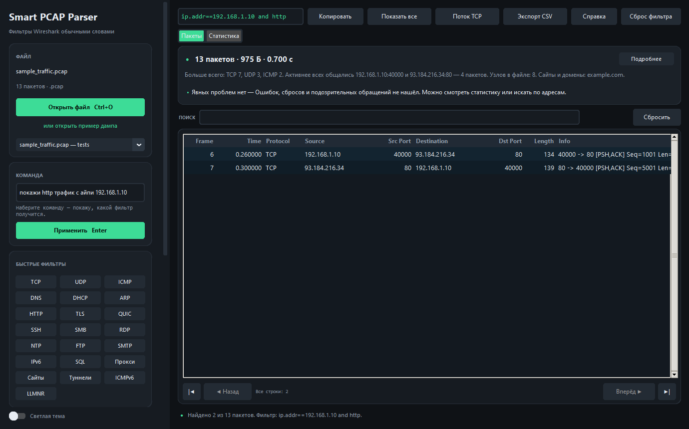

# Smart PCAP Parser

Turn a plain sentence into a Wireshark display filter and instantly see the
matching packets — no tshark, no Wireshark, no AI.

**Русская версия:** [README.md](README.md)



## What it is

Wireshark asks you to write display filters by hand:

```
ip.addr==192.168.1.10 and tcp.port==80
```

This app lets you type:

```
покажи http трафик с айпи 192.168.1.10
```

It extracts the indicators, builds a valid Wireshark filter, applies it to the
capture with its own evaluator and shows the packets. The generated filter can
be copied into Wireshark.

> The command language is Russian-first (the project was built for Russian
> speakers). Filters, protocol names and the generated Wireshark strings are
> language-independent, so the app is still useful as a pcap viewer with a
> plain-language front end.

## Features

- Reads `.pcap` / `.pcapng` (including `.gz`) with the standard library only.
- Ethernet + VLAN, raw IP, loopback, Linux SLL/SLL2, IPv4/IPv6.
- Protocols: TCP, UDP, ICMP, ICMPv6, IGMP, GRE, ESP, AH, OSPF, ARP and
  application protocols (HTTP, HTTP/2, DNS, TLS, QUIC, SSH, SMB, RDP, DHCP,
  DHCPv6, NTP, LLMNR, SSDP, mDNS, NetBIOS, RADIUS, BGP, MQTT, SIP, and more).
- Names from traffic: HTTP Host, TLS SNI, DNS query — shown in the table,
  searchable, summarised in statistics and in the verdict.
- IP defragmentation (IPv4 and IPv6) before TCP/UDP decoding.
- Follow TCP stream and follow UDP conversation, text or hex.
- Own display-filter evaluator: numeric fields, TCP flags, string fields,
  `contains` / `matches`, `in {…}` sets — typical filters copied from the
  internet no longer fail.
- Traffic-over-time chart, protocol hierarchy, conversations, endpoints,
  hosts — on the whole file or on the current filter.
- Plain-language verdict with 10 detectors (unanswered SYNs, resets, DNS gaps,
  port scans, ICMP errors, broadcast storms, top talker, …).
- Dark/light theme; window size, column widths, command history, recent files
  and last folder are remembered between runs.
- Large captures are read in a background thread with a progress bar and a
  Cancel button; the table pages through results of any size.
- 175 checks across 12 test modules, including GUI smoke tests and golden
  filter tests.

## Install and run

### Ready-made Windows build

The whole program is **one file — no installer, no Python**. Grab it from
[Releases](../../releases):

| File | What it is | Size |
| --- | --- | --- |
| **`SmartPCAPParser.exe`** | everything in a single file: download, run | ~13 MB |
| `SmartPCAPParser-<version>-windows-x64.zip` | the same app as a folder (starts a bit faster; useful when a policy blocks single-file executables) | ~13 MB |
| `SHA256SUMS.txt` | checksums to verify the download | 1 KB |

Run `SmartPCAPParser.exe` by double-clicking it. Open a capture with the
“Открыть файл” button, by dropping a file into the window, or like this:

```bash
SmartPCAPParser.exe C:\dumps\capture.pcap
```

A capture dropped onto the `SmartPCAPParser.exe` icon opens as well.

The exe is not code-signed, so SmartScreen may ask whether to run it — normal
for small open-source projects. You can verify a build with
`SmartPCAPParser.exe --selftest` (no window, exit code 0).

Updating is just replacing the exe: settings (theme, command history, recent
files) live separately and survive the update.

### From source

```bash
git clone https://github.com/Whitemoneydealer/SmartPCAPParser.git
cd SmartPCAPParser
pip install -r requirements.txt
python main.py
```

The only runtime dependency is `customtkinter`. Optional: `pip install
tkinterdnd2` enables dragging capture files into the window; everything else
works without it.

### CLI

```bash
python main.py --version
python main.py --demo
python main.py dump.pcap          # open a capture in the window
python main.py --file tests/sample_traffic.pcap -c "покажи http трафик"
python main.py --file tests/sample_traffic.pcap --follow 6 --hex
python main.py --selftest
```

## Build the exe yourself

```bash
pip install -r requirements-dev.txt
python tools/make_icon.py        # optional: regenerate assets/app.ico (needs Pillow)
python tools/build_exe.py        # dist/SmartPCAPParser.exe — single file
python tools/build_exe.py --onedir   # dist/SmartPCAPParser/ + zip
python tools/build_exe.py --both     # both, the way CI does it
python tools/check_exe.py dist/SmartPCAPParser.exe   # --version and --selftest
dist/SmartPCAPParser.exe --selftest
```

`dist/SHA256SUMS.txt` is written next to the artifacts. Pushing a `v*` tag makes
GitHub Actions run the tests, build both variants, self-test each exe and
publish them to Releases.

## Tests

```bash
python -m tests.run_all
```

Golden filter tests (`tests/test_golden.py`) pin down filter semantics against
a fixed sample capture; GUI smoke tests cover the main user flows.

## Benchmarks

Measured with `python tools/bench.py --mb 40` on a synthetic dump
(237 000 packets, 40 MB):

| Step | Result |
| --- | --- |
| Parse headers | 2.5 s (~94 000 packets/s, ~16 MB/s) |
| Parse with payloads | 2.7 s |
| Filter `tcp.port==80 and frame.len > 100` | 0.30 s |
| Assemble one TCP stream | 0.09 s |

## How it works

```
Russian phrase в†’ engine в†’ filters в†’ matcher в†’ pcap_reader в†’ GUI
                              ↘ stats / verdict / streams
```

| Module | Purpose |
| --- | --- |
| `parser/engine.py` | Parse the phrase, extract IPs, ports, MACs, names, protocols |
| `parser/filters.py` | Build the Wireshark display filter |
| `parser/matcher.py` | Compile and evaluate the filter against packets |
| `parser/pcap_reader.py` | Read pcap/pcapng, decode headers, defragment, extract names |
| `parser/streams.py` | TCP streams and UDP conversations |
| `parser/stats.py` | Protocol hierarchy, conversations, endpoints, hosts, timeline |
| `parser/verdict.py` | Plain-language summary and findings |
| `parser/settings.py` | Persist UI settings between runs |
| `gui/app.py` | UI core: file loading, commands, theme, settings |
| `gui/layout.py` | Widget construction |
| `gui/table_view.py` | Packet table: rows, search, sorting, pages |
| `gui/stats_view.py` | Statistics tab |
| `gui/dialogs.py` | Help, packet details, stream window, verdict |
| `gui/theme.py` | Dark/light palettes and UI constants |
| `gui/chart.py` | Traffic chart on a Canvas |

## Limitations

- IPv6: no full extension-header chain (addresses, ports, fragments only).
- Not the whole Wireshark syntax: `tcp.analysis.*` and `http.response.*` are
  not supported.
- Headers of the whole file are kept in memory; payloads are loaded on demand.
  The table keeps up to 500 000 rows — use filters/search on larger captures.
- Exotic link types (ATM, MTP2, Frame Relay) are reported as unsupported.

## License

MIT — see [LICENSE](LICENSE).
