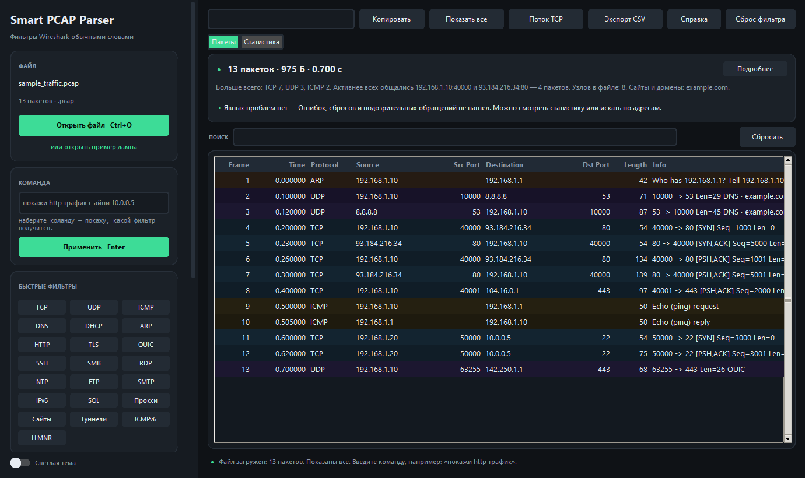
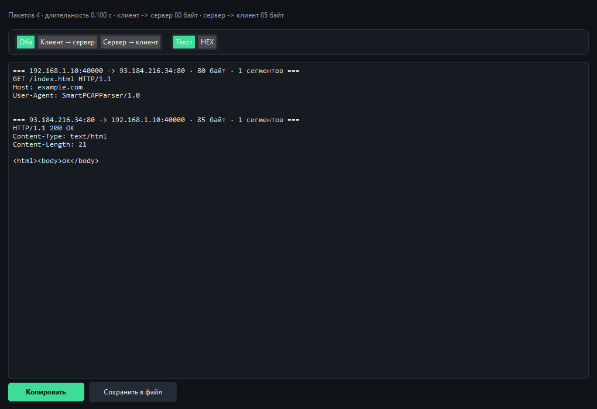
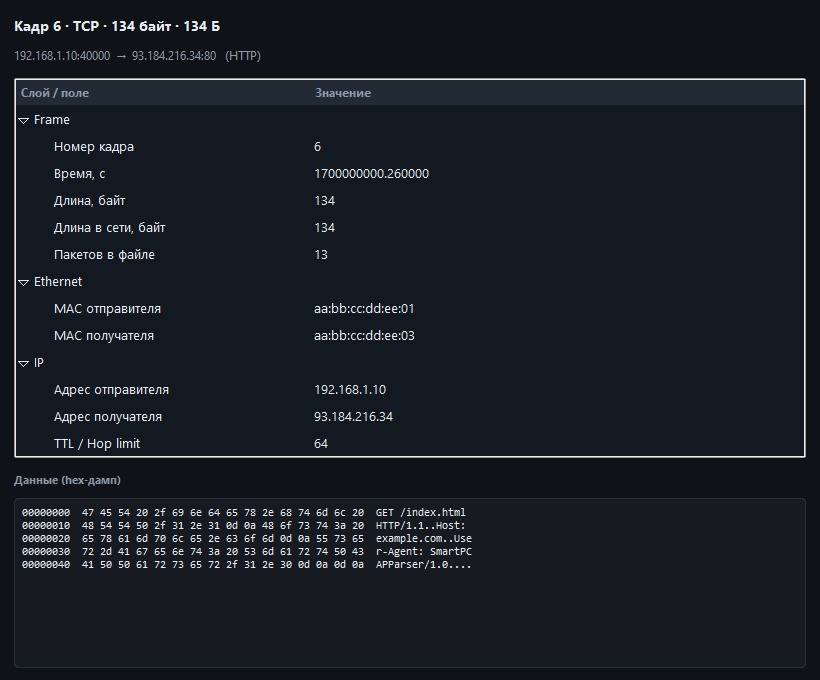
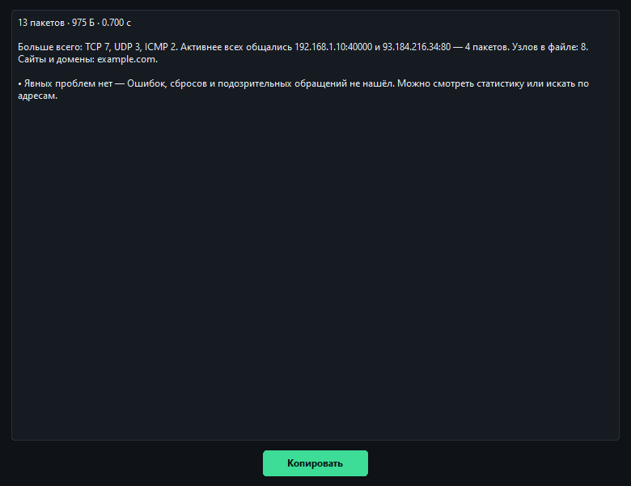
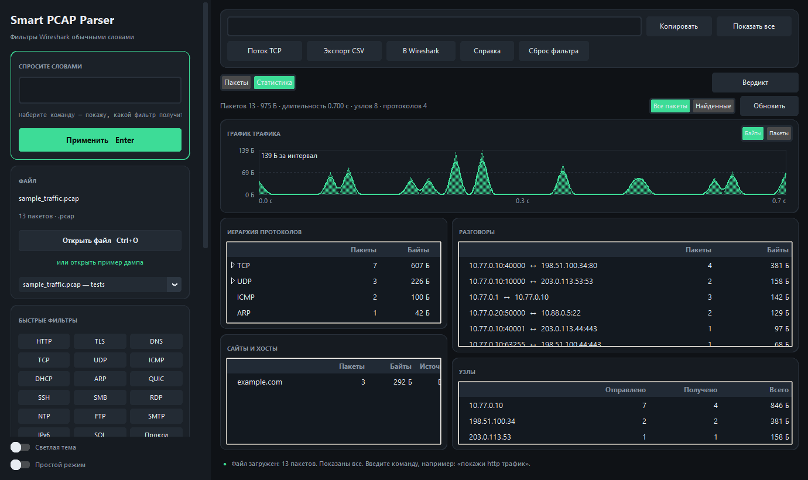
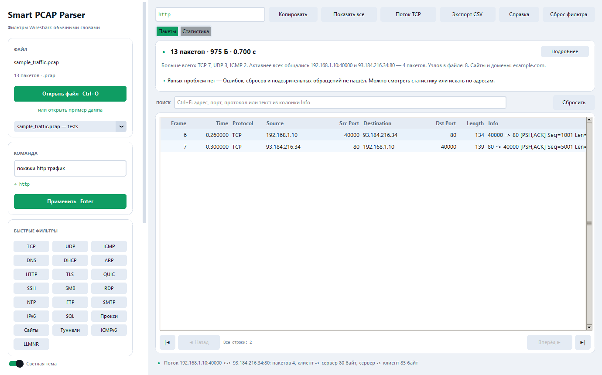

# Smart PCAP Parser

Превращает фразу на русском в фильтр Wireshark и сразу показывает подходящие
пакеты из дампа. Пишешь «покажи http трафик с айпи 192.168.1.10» вместо
`ip.addr==192.168.1.10 and tcp.port==80`, и через секунду видишь таблицу.

Сделал для себя: надоело каждый раз вспоминать синтаксис полей, когда нужно
просто посмотреть, что в файле. Нейросетей здесь нет, только словари,
регулярки и свой разбор pcap. tshark и Wireshark для работы не нужны,
они пригодятся разве что сверить результат.



[English version](README.en.md) · [История изменений](CHANGELOG.md)

## Скачать

Готовая программа для Windows, один файл, без установки и без Python.
Берите со страницы [Releases](../../releases):

| Файл | Что это | Размер |
| --- | --- | --- |
| `SmartPCAPParser.exe` | вся программа одним файлом | ~13 МБ |
| `SmartPCAPParser-<версия>-windows-x64.zip` | то же папкой, стартует быстрее; выручает, если политика запрещает одиночные exe | ~13 МБ |
| `SHA256SUMS.txt` | контрольные суммы | 1 КБ |

Прямая ссылка на свежую версию, удобно кинуть в закладки:

```
https://github.com/Whitemoneydealer/SmartPCAPParser/releases/latest/download/SmartPCAPParser.exe
```

Запуск: двойной клик. Дамп открывается кнопкой «Открыть файл», перетаскиванием
в окно или из командной строки:

```
SmartPCAPParser.exe C:\dumps\capture.pcap
```

Файл, брошенный на иконку exe, тоже открывается.

SmartScreen может спросить про запуск: файл не подписан сертификатом, для
небольших открытых проектов это нормально. Убедиться, что сборка целая,
можно так: `SmartPCAPParser.exe --selftest` (окно не открывается, код 0).

Обновление сводится к замене exe. Тема, история команд и недавние файлы
лежат отдельно и никуда не денутся.

Если запускать из исходников:

```bash
git clone https://github.com/Whitemoneydealer/SmartPCAPParser.git
cd SmartPCAPParser
pip install -r requirements.txt
python main.py
```

Из зависимостей только `customtkinter`, остальное стандартная библиотека.
На Windows можно дважды кликнуть по `run.bat`: он найдёт Python, в котором
есть `customtkinter`, и подскажет команду установки, если библиотеки нет.

## Зачем

В Wireshark фильтр выглядит так:

```
ip.addr==192.168.1.10 and tcp.port==80
```

А хочется написать так:

```
покажи http трафик с айпи 192.168.1.10
```

Программа вытаскивает из фразы адреса, порты, протоколы и имена, собирает
фильтр, применяет его к файлу и заполняет таблицу. Готовый фильтр можно
скопировать и вставить в Wireshark, синтаксис там тот же.

## Что умеет

Читает `.pcap` и `.pcapng`, в том числе сжатые `.pcap.gz` и `.pcapng.gz`.
Понимает Ethernet с VLAN, raw IP, loopback, Linux SLL/SLL2 и готовые
IPv4/IPv6-кадры. Внутри IPv4, IPv6, ARP, TCP, UDP, ICMP, ICMPv6, IGMP, GRE,
ESP, AH, OSPF.

Прикладные протоколы: HTTP, HTTP/2, DNS, TLS, QUIC, SSH, FTP, SMTP, NTP,
DHCP, DHCPv6, Telnet, POP3, IMAP, LDAP, SMB, RDP, MySQL, mDNS, LLMNR, SSDP,
NetBIOS, RADIUS, BGP, XMPP, IRC, L2TP, IPsec (IKE), MSSQL, PostgreSQL,
MongoDB, Redis, Memcached, NFS, SIP, SNMP, TFTP, VNC, MQTT, Kerberos, Syslog,
STUN, OpenVPN, SOCKS.

Часть протоколов определяется по содержимому, а не по номеру порта. HTTP/2 по
префиксу соединения, HTTP по первым байтам запроса, TLS по записи
handshake, SSH по баннеру, SIP по `INVITE` и `SIP/2.0`, MQTT по `CONNECT`,
DNS поверх TCP по длине сообщения. Это работает и на нестандартных портах.

Имена из трафика (HTTP Host, TLS SNI, домен из DNS-запроса) попадают в
колонку Info, в статистику, в детали пакета и в вердикт. Команда «покажи
сайт example.com» ищет сразу по всем трём местам, независимо от того, HTTP
это, HTTPS или DNS.

Фрагменты IPv4 и IPv6 собираются обратно в датаграмму, после чего
разбирается TCP или UDP. В строке видно «собран из N фрагментов».

Таблица как в Wireshark: Frame, Time, Protocol, Source, Src Port,
Destination, Dst Port, Length, Info. Порты отдельными колонками, строка
подкрашена по транспорту, сортировка кликом по заголовку.

Фильтр можно не набирать, а взять из ячейки: правая кнопка по строке даёт
«только от этого адреса», «только к этому адресу», «только порт 443»,
«только TCP».

Двадцать две кнопки быстрых фильтров: TCP, UDP, ICMP, DNS, DHCP, ARP, HTTP,
TLS, QUIC, SSH, SMB, RDP, NTP, FTP, SMTP, IPv6, SQL, прокси, сайты, туннели,
ICMPv6, LLMNR. Остальные протоколы набираются словами.

Поиск по таблице по `Ctrl+F`: адрес, порт, протокол, имя сайта, кусок Info.
Счётчик показывает «12 из 200», `Esc` снимает поиск. Поиск работает поверх
фильтра и сам фильтр не меняет, в CSV уходит ровно найденное.

Таблица листается страницами по 5000 строк, до 50 000 показывается сразу,
дальше кнопки страниц и `Ctrl+PgUp`/`Ctrl+PgDn`. Экспорт в CSV открывается
в Excel, кириллица не ломается.

Под полем команды есть живая подсказка: показывает будущий фильтр ещё до
`Enter` и объясняет, что не так («адрес 192.168.1.999 некорректен», «порт
99999 вне диапазона», «адрес похож на IPv6, но записан с ошибкой»).

Большой файл читается в фоне, с полоской прогресса и кнопкой «Отмена».
Тела пакетов не дублируются в памяти: они подгружаются, когда открываешь
поток.

Темы две, тёмная и светлая, `Ctrl+L`. Настройки переживают перезапуск: тема,
размер и положение окна, ширина колонок, история команд, последняя папка,
область статистики. Недавние файлы открываются из списка под кнопкой
«Открыть файл».

Горячие клавиши: `Ctrl+O` открыть, `Enter` применить команду, `Ctrl+F`
поиск, `Ctrl+T` поток TCP, `Ctrl+L` тема, `Ctrl+PgUp`/`Ctrl+PgDn` страницы,
`F1` справка, `Esc` сброс фильтра.

Если поставить `tkinterdnd2`, файл можно перетащить в окно мышью. Без
библиотеки работает всё остальное.

## Команды

| Пишете | Фильтр |
| --- | --- |
| `найди пакеты с айпи 192.168.1.1` | `ip.addr==192.168.1.1` |
| `пакеты от 10.0.0.5` | `ip.src==10.0.0.5` |
| `пакеты к 8.8.8.8` | `ip.dst==8.8.8.8` |
| `выведи пакеты на порт 80` | `tcp.port==80` |
| `порты от 20 до 23` | `tcp.port in {20..23}` |
| `покажи http трафик` | `http` |
| `найди dns запросы` | `dns` |
| `https трафик` | `tls` |
| `покажи сайт example.com` | host или SNI или DNS-имя с `example.com` |
| `не http` | `not (http)` |
| `покажи всё кроме 8.8.8.8` | `not (ip.addr==8.8.8.8)` |
| `покажи http трафик с айпи 10.0.0.1` | `ip.addr==10.0.0.1 and http` |
| `покажи почту` | `(smtp or pop3 or imap)` |
| `покажи базы данных` | `(mysql or tds or pgsql or mongo or redis or memcached)` |
| `покажи удалённый доступ` | `(rdp or ssh or vnc or telnet)` |
| `общая папка` | `smb` |
| `покажи телефонию` | `(sip or stun)` |

Формулировки можно менять: «айпи», «ip», «адрес», «айпишник», «порт»,
«номер порта», «мак», «трафик», «пакеты», «покажи», «выведи», «найди»,
«глянь», «дай», «отфильтруй», «хочу увидеть», «грепни». Окончания тоже не
важны: «телефонию», «почту», «шару» и «базу данных» движок понимает.

Кроме имён протоколов в словаре есть бытовые названия: «общая папка» даёт
`smb`, «удалённый рабочий стол» даёт `rdp`, «пинг» даёт `icmp`,
«синхронизация времени» даёт `ntp`, «принтер» даёт `mdns`, «сертификаты»
дают `tls`, «умный дом» даёт `mqtt`, «логи» дают `syslog`, «прокси» даёт
`socks`, «маршрутизация» даёт `bgp or ospf or icmp or igmp`.

Полсотни готовых примеров собраны в [docs/EXAMPLES.md](docs/EXAMPLES.md).

## Готовый фильтр Wireshark

Если синтаксис знаком, вставляйте фильтр как есть. Приложение само поймёт,
что это фильтр, и не станет искать в нём русские слова.

```
tcp.port==443
ip.addr==10.0.0.1 and http
frame.len > 1000
tcp.flags.syn==1
http.host contains "example.com"
```

Неизвестное поле не приводит к пустой таблице: внизу появится сообщение,
какие поля поддерживаются. Это поля адресов, портов, MAC, чисел (`frame.len`,
`ip.ttl`, `tcp.len`, `tcp.window_size`), флагов TCP, имён (`http.host`,
`dns.qry.name`, `tls.sni`) и `tcp contains текст`. Подробности в
[docs/EXAMPLES.md](docs/EXAMPLES.md).

## Поток TCP и UDP

Выделите TCP-пакет и нажмите «Поток TCP», `Ctrl+T` или правую кнопку.
Приложение соберёт все пакеты соединения и склеит данные в две стороны.

Поток определяется по паре «адрес:порт ↔ адрес:порт». Клиент определяется
по SYN без ACK, если такого нет, по отправителю первого пакета. Сегменты
раскладываются по sequence number: дубликаты отбрасываются, перекрытия
обрезаются, порядок пакетов в файле не важен. Потерянные байты помечаются
как `[пропущено N байт]`, переполнение 32-битного счётчика обрабатывается
по RFC 1982.

Для UDP открывается «Поток UDP»: датаграммы по порядку захвата, отдельно в
каждую сторону. Удобно для DNS, NTP, игрового и медиа-трафика.

В окне потока переключатели «Оба / Клиент → сервер / Сервер → клиент» и
«Текст / HEX», кнопки «Копировать» и «Сохранить в файл».



Если файл больше 25 МБ, тела пакетов в памяти не держатся. При открытии
потока приложение дочитывает из файла только кадры этого соединения, до
64 МБ.

## Детали пакета

Двойной клик по строке открывает разбор по слоям: Frame, Ethernet, IP,
TCP или UDP, «Имена», приложение. Для TCP видны порты, sequence, окно,
расшифровка флагов (`SYN, ACK`) и hex-дамп полезной нагрузки.



## Вердикт

Сразу после открытия файла над таблицей появляется короткий текст: сколько
пакетов, какой объём, длительность, каких протоколов больше, кто с кем
общался, какие сайты видны.

Дальше находки: SYN без ответа, сбросы RST, DNS без ответов, много ARP,
обращения из локальной сети к SMB, RDP, Telnet, VNC, MySQL, MSSQL, FTP,
скан портов с одного адреса, повторяющиеся ICMP-ошибки, широковещательный
шторм, самый активный узел, неразобранные кадры.

У каждой находки есть кнопка «Показать», она применяет нужный фильтр. Счёт
идёт по всему файлу, а не по отфильтрованным строкам. «Подробнее» открывает
полный текст, его можно скопировать.



## Статистика

Вкладка рядом с «Пакеты»:

- график трафика по времени, переключатель «Байты / Пакеты», при наведении
  видно время и объём интервала;
- иерархия протоколов, с долями от всех пакетов;
- сайты и хосты из Host, SNI и DNS;
- разговоры: пары узлов и объём между ними;
- узлы: адреса и сколько отправили и получили.

Переключатель «Все пакеты / Найденные» решает, что считать: весь файл или
только строки под текущим фильтром. Кнопка «Обновить» пересчитывает вручную.



## Настройки

Файл настроек лежит в домашней папке: `~/.smartpcapapp/settings.json`. В
репозитории его нет. Если файл испорчен, приложение молча берёт значения по
умолчанию и всё равно открывается.



## Консольный режим

```bash
python main.py --version     # версия
python main.py --selftest    # самопроверка: чтение, фильтры, потоки
python main.py dump.pcap     # открыть файл в окне

# разбор примеров команд
python main.py --demo

# проверить команду без окна
python main.py --file tests/sample_traffic.pcap -c "покажи http трафик"

# поток кадра 6: текстом, hex-дампом или одним направлением
python main.py --file tests/sample_traffic.pcap --follow 6
python main.py --file tests/sample_traffic.pcap --follow 6 --hex
python main.py --file tests/sample_traffic.pcap --follow 6 --dir client
```

## Сборка exe

```bash
pip install -r requirements-dev.txt
python tools/make_icon.py               # перерисовать иконку, нужен Pillow
python tools/build_exe.py               # один файл
python tools/build_exe.py --onedir      # папка плюс zip
python tools/build_exe.py --both        # оба варианта, так делает CI
python tools/check_exe.py dist/SmartPCAPParser.exe
```

Рядом с файлами появляется `dist/SHA256SUMS.txt`. По тегу `v*` сборку
запускает GitHub Actions: тесты, оба варианта, самопроверка, публикация в
Releases.

## Скорость

Синтетический дамп на 40 МБ, 237 000 пакетов, обычный ноутбук:

| Шаг | Время |
| --- | --- |
| Разбор заголовков | 2.5 с, около 94 000 пакетов в секунду |
| Разбор с телами | 2.7 с |
| Фильтр `tcp.port==80 and frame.len > 100` | 0.3 с |
| Сборка TCP-потока | 0.09 с |

Повторить: `python tools/bench.py --mb 100`.

## Тесты

```bash
python -m tests.run_all
```

177 проверок в 12 модулях. Отдельно есть golden-тесты: таблица «фильтр →
номера кадров», которая ловит незаметные изменения в семантике.

Тестовые дампы создаёт `python tests/generate_sample_pcap.py`: ARP, DNS,
HTTP, TLS, SSH и ICMP, 13 пакетов.

Синтетика всегда проходит, поэтому есть прогон на настоящих файлах: 54
дампа из открытого репозитория Wireshark, включая `.gz`, IPv6, QUIC,
HTTP/2 и экзотические типы кадров.

```bash
python tools/fetch_samples.py    # скачать корпус в samples/
python -m tests.test_corpus      # прогнать через конвейер
```

Если папки `samples/` нет, тест пропускается, а не падает.

## Ограничения

- IPv6 разбирается без цепочки extension-заголовков глубже четырёх.
- UDP не переупорядочивается, датаграммы идут в порядке захвата.
- Заголовки всех пакетов читаются в память. Файлы больше 25 МБ открываются
  без тел, тела дочитываются при открытии потока (до 64 МБ на поток).
  В таблице до 500 000 строк, на дампах в миллионы пакетов работайте
  фильтром и поиском.
- Экзотические кадры (ATM, MTP2, Frame Relay) не разбираются, вердикт
  говорит об этом прямо.
- Вычислитель знает перечисленные поля, но не весь синтаксис Wireshark.
  `tcp.analysis.*` и `http.response.*` не поддерживаются.
- Расшифровки TLS нет.

## Документация

- [docs/EXAMPLES.md](docs/EXAMPLES.md): фразы и фильтры, которые из них
  получаются
- [docs/FAQ.md](docs/FAQ.md): SmartScreen, форматы, приватность, большие
  файлы
- [CONTRIBUTING.md](CONTRIBUTING.md): как собрать и запустить тесты
- [SECURITY.md](SECURITY.md): куда писать про уязвимости
- [CHANGELOG.md](CHANGELOG.md): что менялось

## Структура

```
SmartPCAPParser/
├── main.py                 точка входа: GUI, консоль, --selftest
├── run.bat                 запуск из исходников
├── parser/                 разбор pcap, движок фраз, фильтры, потоки,
│                           статистика, вердикт, настройки
├── gui/                    окно, таблица, график, диалоги, справка
├── tests/                  тесты и дампы
├── tools/                  сборка exe, бэкап, бенчмарк, публикация
├── docs/                   примеры, FAQ, скриншоты
└── assets/app.ico          иконка
```

Каждый модуль начинается с короткого описания, что он делает. Этого хватает,
чтобы найти нужное место.

## Лицензия

MIT, смотрите [LICENSE](LICENSE). Берите код, меняйте, используйте в своих
проектах.
